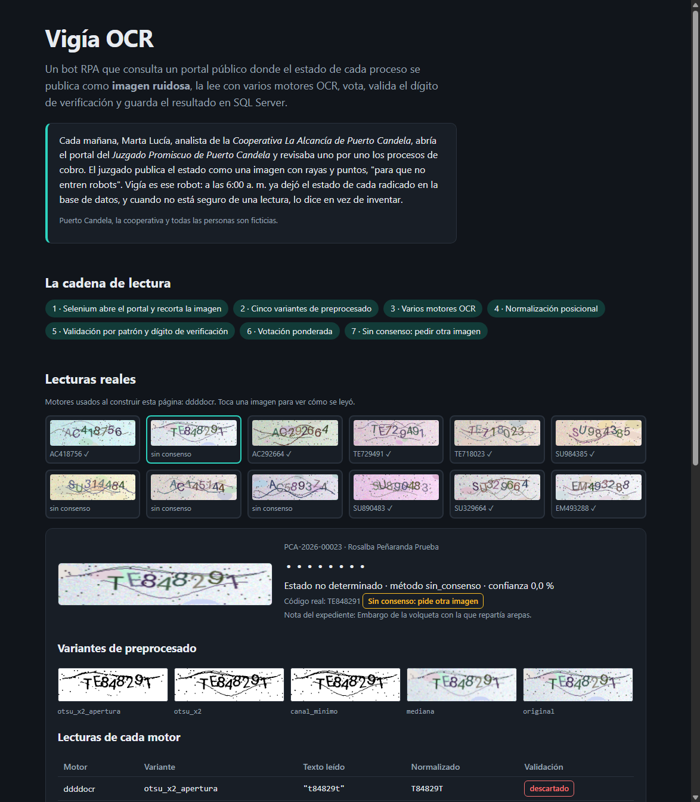
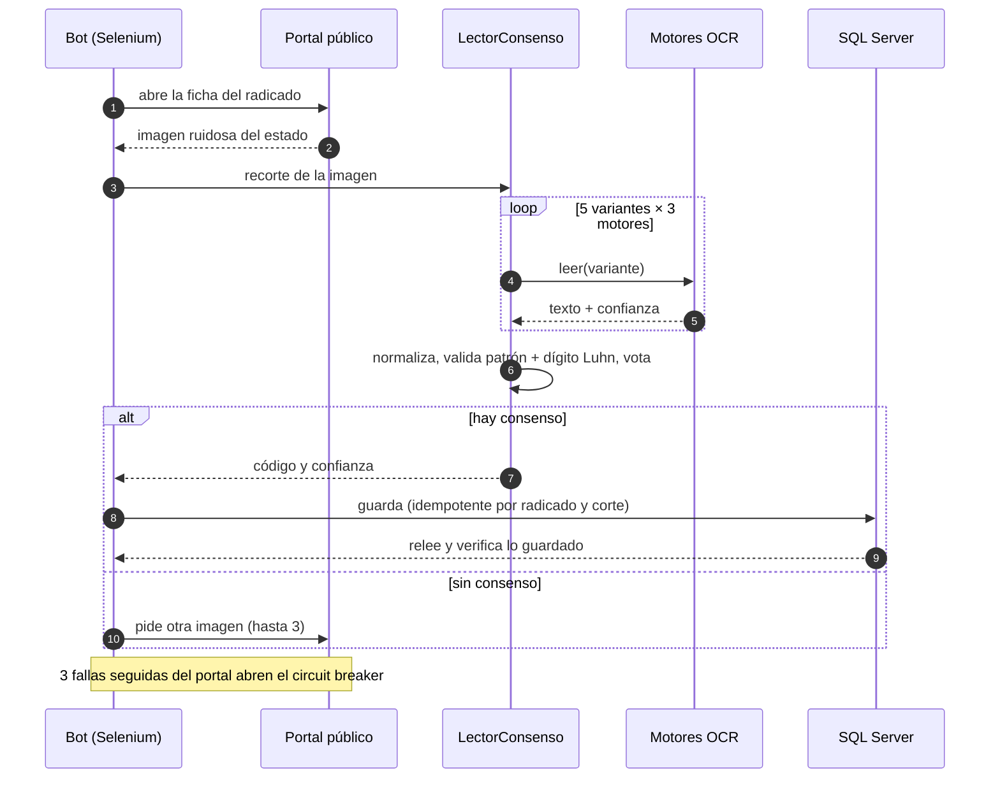

# 👁️ Vigía OCR

[](https://github.com/DarwinMontiel/vigia-ocr/actions/workflows/ci.yml)
[](https://darwinmontiel.github.io/vigia-ocr/)


[](LICENSE)

**Bot RPA que consulta un portal público donde el estado de cada proceso se publica como imagen
ruidosa, la lee con varios motores OCR, vota, valida un dígito de verificación y guarda el
resultado en SQL Server**, con idempotencia, verificación tras guardar y *circuit breaker*.

**[Ver la demo en vivo →](https://darwinmontiel.github.io/vigia-ocr/)** lecturas reales de la cadena, imagen por imagen.

> Cada mañana, Marta Lucía, analista de la *Cooperativa La Alcancía de Puerto Candela*, abría el
> portal del *Juzgado Promiscuo de Puerto Candela* y revisaba uno por uno los procesos de cobro.
> El juzgado publica el estado como una imagen con rayas y puntos. Vigía es el robot que hace ese
> trabajo: a las 6:00 a. m. ya dejó el estado de cada radicado en la base de datos y, **cuando no
> está seguro de una lectura, lo dice en vez de inventar**.
>
> <sub>Puerto Candela, la cooperativa y todas las personas son ficticias.</sub>



## El resultado: de 48,6 % a 98,2 % de acierto

El banco de evaluación genera 500 imágenes sintéticas con semilla fija y mide cada capa de la
cadena por separado. Estos son los números **medidos**, no estimados
([tabla completa](docs/evaluacion.md) · [metodología](docs/evaluacion-metodologia.md)):

| Capa | Acierto | Error silencioso | Sin respuesta |
|---|--:|--:|--:|
| 1 · Un motor (ddddocr), imagen cruda | 48,6 % | **51,4 %** | 0,0 % |
| 2 · + preprocesado y normalización | 65,6 % | 34,4 % | 0,0 % |
| 3 · + 5 variantes, votación y dígito de verificación | 74,0 % | 0,2 % | 25,8 % |
| 4 · + votación entre 3 motores | 82,6 % | 0,6 % | 16,8 % |
| **5 · Producción: si no hay consenso, pide otra imagen** | **98,2 %** | **0,6 %** | 1,2 % |

Lo importante no es solo el acierto: el **error silencioso** (un código equivocado que termina en
la base de datos) baja de 51,4 % a 0,6 %. La cadena prefiere decir "no sé" y pedir otra imagen
(1,21 imágenes por caso en promedio) antes que adivinar. La ablación muestra qué aporta cada motor:
sin ddddocr el acierto cae a 81,2 %; sin Tesseract no cambia, pero las lecturas por caso bajan de
9,21 a 6,39.

```bash
make evaluar          # regenera docs/evaluacion.md con los motores instalados
```

## Cómo funciona



| Decisión | Por qué | ADR |
|---|---|---|
| Arquitectura hexagonal | El núcleo no conoce Selenium, SQL Server ni OCR; una prueba lo impide | [0001](docs/adr/0001-arquitectura-hexagonal.md) |
| Varios motores con votación ponderada | Cada motor falla distinto; juntos se corrigen | [0002](docs/adr/0002-cadena-ocr-con-votacion.md) |
| Dígito de verificación (Luhn) | Descarta lecturas imposibles antes de votar | [0003](docs/adr/0003-validacion-por-digito-de-verificacion.md) |
| Pedir otra imagen antes que adivinar | Un error silencioso cuesta más que una consulta extra | [0004](docs/adr/0004-pedir-otra-imagen-antes-que-adivinar.md) |
| Idempotencia y verificación tras guardar | Reintentar nunca duplica; lo guardado se relee | [0005](docs/adr/0005-idempotencia-y-verificacion-tras-guardar.md) |
| Circuit breaker | Si el portal se cae, el bot espera en vez de martillarlo | [0006](docs/adr/0006-circuit-breaker-ante-caidas-del-portal.md) |
| Selenium y recorte desde la captura | La imagen cambia en cada petición: se lee la que se vio | [0007](docs/adr/0007-selenium-y-recorte-desde-la-captura.md) |
| Datos sintéticos con semilla | Resultados reproducibles y sin datos de personas reales | [0008](docs/adr/0008-datos-sinteticos-y-banco-de-evaluacion.md) |

Más detalle en [docs/arquitectura.md](docs/arquitectura.md) y la operación diaria en el
[runbook](docs/runbook.md).

## Inicio rápido

```bash
python -m venv .venv && source .venv/bin/activate   # Windows: .venv\Scripts\activate
make install                       # paquete + ddddocr y Tesseract + herramientas
vigia portal &                     # portal ficticio en http://127.0.0.1:8000
vigia consultar datos/radicados_demo.csv   # el bot consulta el lote y guarda en SQLite
vigia leer muestras/*.png          # lee imágenes sueltas y muestra el voto de cada motor
```

Con Docker (portal + bot; SQL Server opcional):

```bash
docker compose up --build portal bot
MSSQL_ACEPTO_EULA=Y MSSQL_SA_PASSWORD='...' docker compose --profile sqlserver up -d
```

El esquema de SQL Server (tablas, índice único de idempotencia y vista del último estado) está
en [`sql/001_esquema.sql`](sql/001_esquema.sql).

## Pruebas y calidad

| Comando | Qué cubre |
|---|---|
| `make test` | 148 pruebas unitarias con dobles: dominio, votación, circuit breaker, repositorios, CLI y arquitectura |
| `make test-ocr` | Motores reales (ddddocr y Tesseract) |
| `make e2e` | El bot real con Selenium + Chrome contra el portal ficticio |
| `make test-sqlserver` | Repositorio contra SQL Server 2022 |
| `make lint` | Ruff y mypy estricto |

El CI corre las unitarias en Python 3.11, 3.12 y 3.13, los motores OCR reales con el banco de
evaluación, el E2E con Chrome y la imagen Docker. La prueba contra SQL Server corre cuando el
dueño acepta la licencia de Microsoft (variable `MSSQL_ACEPTO_EULA`).

## Qué demuestra / relación con mi experiencia

En una fintech de gestión de cartera construí bots que leen imágenes en portales públicos con
**ddddocr, EasyOCR y Tesseract**, y llevé el acierto de **≈65 % a ≈99 %**. Este repositorio es una
versión propia y pública de ese problema, con datos ficticios, que muestra el método: medir cada
capa, preferir "no sé" a un error silencioso y guardar con **idempotencia y verificación** en
**SQL Server**. Es hermano de [colmena-rpa](https://github.com/DarwinMontiel/colmena-rpa) (bots
por colas) y lo vigila [torre-de-control](https://github.com/DarwinMontiel/torre-de-control).

## Estructura

```
src/vigia_ocr/
├── dominio/          # código y dígito Luhn, normalización, votación (sin dependencias)
├── aplicacion/       # ServicioConsulta, LectorConsenso, CircuitBreaker
├── puertos/          # contratos (typing.Protocol)
├── adaptadores/      # Selenium, motores OCR, preprocesado, SQLAlchemy, reloj
├── evaluacion/       # banco de evaluación por capas y ablación
├── sintetico/        # generador de imágenes con semilla
├── portal_ficticio/  # portal FastAPI del juzgado de Puerto Candela
└── demo_web/         # demo estática para GitHub Pages
```

## Licencia

[MIT](LICENSE) · Hecho por [Darwin Montiel Mora](https://darwinmontiel.github.io).
