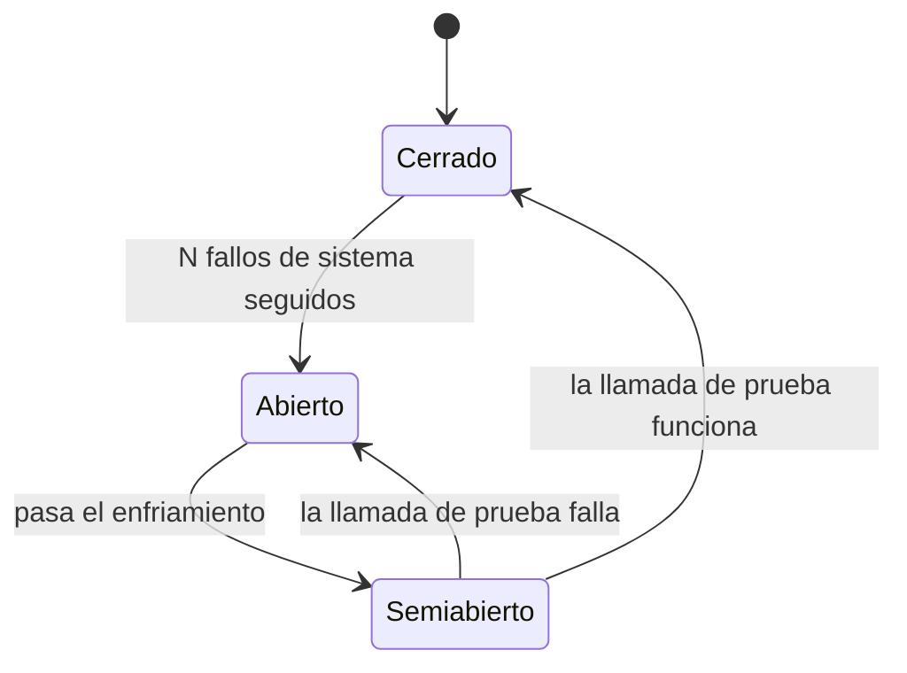

# ADR-0006 · Circuit breaker ante caídas del portal

- **Estado:** aceptada
- **Fecha:** 2026-11

## Contexto

Los portales públicos se caen, sobre todo en horas pico o en ventanas de mantenimiento. Un
bot que sigue consultando un portal caído gasta minutos en *timeouts*, llena los logs de
ruido y, peor, contribuye a la carga de un servicio que ya está en problemas.

## Decisión

Toda llamada al portal pasa por un `CircuitBreaker` con tres estados:

- Solo cuentan como fallo los **errores de sistema** (`PortalNoDisponible`: *timeout*, HTTP
  503, navegador caído). Un radicado inexistente es una respuesta válida del portal y no
  abre el circuito.
- Con el circuito abierto, los radicados restantes se marcan `circuito_abierto` sin tocar
  el portal y quedan pendientes para la siguiente corrida.
- El reloj es un puerto (`Reloj`): las pruebas avanzan el tiempo sin dormir.

Valores por defecto: 3 fallos seguidos, 30 s de enfriamiento
(`VIGIA_BREAKER_UMBRAL_FALLOS`, `VIGIA_BREAKER_ENFRIAMIENTO_S`).

## Consecuencias

- Un lote contra un portal caído termina en segundos con un resumen claro, en lugar de
  agotar *timeouts* radicado por radicado.
- El portal ficticio incluye `POST /_simulacion/caida` y `--tasa-fallos` para demostrarlo;
  la prueba E2E tumba el portal a mitad de un lote y verifica que el circuito se abra.
