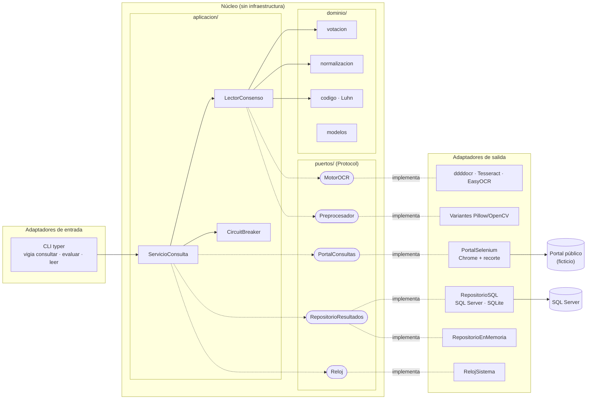
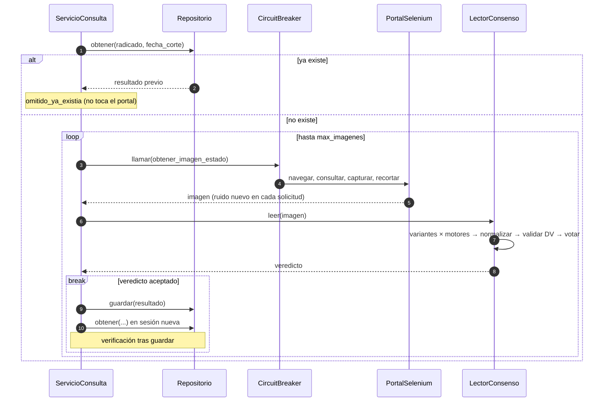
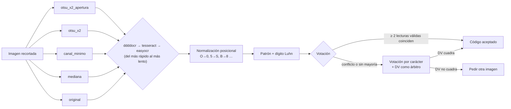
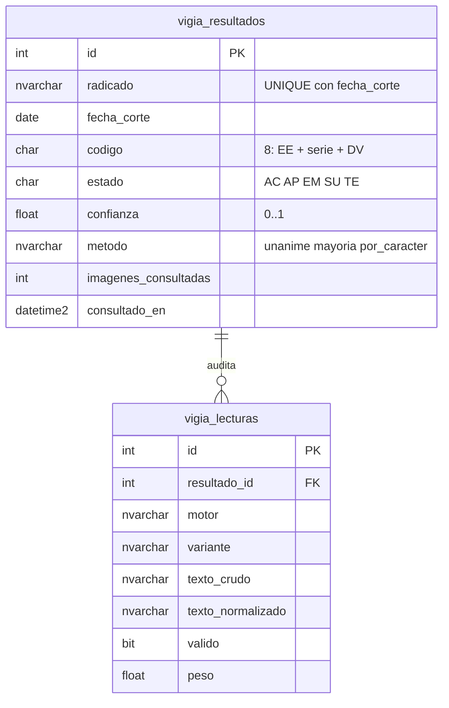

# Arquitectura

Vigía OCR sigue una **arquitectura hexagonal** ([ADR-0001](adr/0001-arquitectura-hexagonal.md)):
el núcleo no sabe que existen Selenium, SQL Server ni los motores OCR; solo conoce
contratos (puertos). Los adaptadores implementan esos contratos.

## Vista general

La raíz de composición (`contenedor.py`) es el único módulo que importa a la vez núcleo y
adaptadores. `tests/unitarias/test_arquitectura.py` verifica estas fronteras en cada
ejecución de pruebas.

## Flujo de un radicado

## Cadena de lectura

## Puertos y adaptadores

| Puerto | Contrato | Adaptadores |
|---|---|---|
| `PortalConsultas` | `obtener_imagen_estado(radicado) -> Image` · lanza `RadicadoInexistente` o `PortalNoDisponible` | `PortalSelenium` (producción), `PortalGuion` (pruebas) |
| `MotorOCR` | `nombre`, `leer(imagen) -> str` | `MotorDdddocr`, `MotorTesseract`, `MotorEasyOCR`, dobles de prueba |
| `Preprocesador` | `nombre`, `aplicar(imagen) -> Image` | `Variante` (cadena de pasos OpenCV) |
| `RepositorioResultados` | `obtener(radicado, corte)`, `guardar(resultado) -> bool` | `RepositorioSQL` (SQL Server / SQLite), `RepositorioEnMemoria` |
| `Reloj` | `ahora()`, `monotonico()` | `RelojSistema`, `RelojFalso` (pruebas) |

## Errores

| Tipo | Ejemplos | Qué hace el caso de uso |
|---|---|---|
| `ErrorDeNegocio` | `RadicadoInexistente` | Registra el desenlace y sigue; no se reintenta. No abre el circuito. |
| `ErrorDeSistema` | `PortalNoDisponible`, `CircuitoAbierto` | El radicado queda pendiente; cuenta para el circuit breaker. |
| `ErrorVerificacion` | Lo guardado no coincide con lo leído | Detiene el lote: la base de datos no es confiable. |
| `MotorNoDisponible` | Falta el binario de Tesseract | Al arrancar: se omite el motor (configurable). Durante la lectura: se propaga. |

## Modelo de datos

El DDL para SQL Server está en [`sql/001_esquema.sql`](../sql/001_esquema.sql) (idempotente,
con `CHECK` y una vista `vigia_ultimo_estado`). Una prueba unitaria compara sus tablas y
columnas con el modelo del ORM para que no diverjan.
